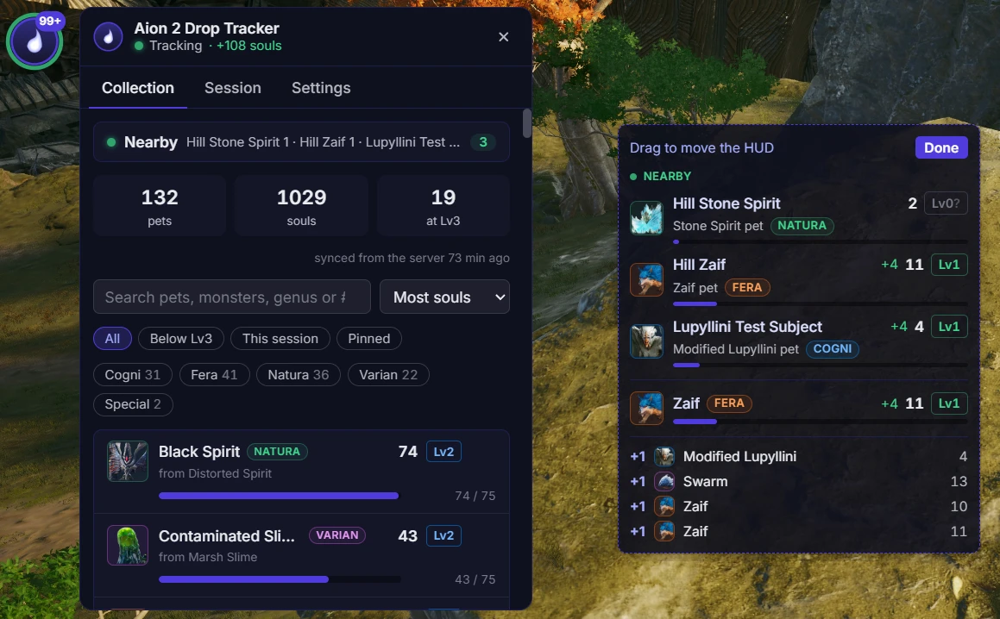

# Lokthar overlay

> **Lokthar's overlay based on** [xCROv/aion2-nyerk](https://github.com/xCROv/aion2-nyerk)

A Windows overlay that counts your Aion 2 Pet Collection souls as they drop, so you don't have
to keep opening the Pets menu.

- **Live counts:** every soul is counted the moment it drops, with level-ups (5 → 25 → 75) and the
  genus crystals that maxed (Lv3) pets give instead.
- **Login sync:** when you enter the world, your whole collection is taken from the game, so the
  counts always match the Pets menu.
- **In-game HUD:** a small click-through overlay with nearby soul monsters, this fight's pets and
  a feed of drops. It clears itself between fights.
- **Spanish or English:** the whole app in Spanish (the default) or English, switched on Home or in
  Settings. Game words stay as the community says them (PvP, DPS, skills, buffs, bosses, pets).
- **Dashboard:** Alt+E (or the bubble) opens it, and Alt+E again puts it away: a Home page with every overlay's switch and a
  summary of each page, then Combat Meter, Map, Pets, PvP, Buffs, Event Alerts, Field Bosses,
  History and Session. Each overlay's settings are on its page.
- **Pets:** every pet with its genus, level and progress; search, filter, pin pets to the HUD and
  the maps, and see where each soul drops on a map.
- **Kina per hour:** this session's Kina rate with a timeline, in the panel and on the HUD.
- **Event Alerts and Field Bosses:** the game's events (Shugo Festival, the Black Cloud Merchant,
  rifts, the siege…) with countdowns, and Verteron's field bosses read from the map's field boss
  list, each with an optional alert.
- **Countdown bar:** the timers whose alert you turned on, starting within 13 hours, as a small
  bar of icons and countdowns over the game.
- **Hidden Cubes:** a cube in view (within about 100 m) shows at the top of the HUD with how far
  and which way, with a chime, and as a golden cube on the maps.
- **Map:** your zone around you in a small overlay that follows you, and any zone on the Map page,
  with your tracked pets' spawns (or every pet you still need) and the Hidden Cubes.
- **Buffs:** your buffs and debuffs over the game with their stacks and time left, and each
  fight's buffs (every player's and the target's, with uptimes) in its Details window.
- **PvP log and kill feed:** every player kill around you, as the game credits it, on the PvP
  page and in a small kill feed over the game; yours and your legion's marked.
- **Black Cloud Merchant:** when you open one of its tabs, a window lists the pets it sells that
  you have not maxed, with where their soul monsters spawn.
- **One collection per server:** as in the game, your characters on a server share one; one on
  another server has its own.
- **DPS meter:** its own window while you play, from A2Tools DPS Meter's parser: damage, healing or
  damage taken; all targets, bosses or your target; only you, you and your party, or everyone. The
  target's HP and time to kill, crit rates and your ping. Click a player for their details: skills,
  hits (crits, back attacks, perfect, multi-hits), defense, rotation and buffs. Boss fights are
  saved, and the History page opens them again.
- **Training dummy:** runs against the clock or to a damage goal, saved with their skills' DPS and
  the meter's whole breakdown (hits, defense, rotation, buffs) in the Details window, and compared
  two at a time, skill by skill.
- **Recordings:** the game's traffic during a fight, kept to replay it in the engine after a patch.
- **Stays out of the way:** it sits in the tray and sleeps while Aion 2 is closed, waking when the
  game starts.




## How it works

The tracker **only listens** and functions the exact same as popular DPS Meters used in Aion 2. It reads the game's network traffic passively through
[Npcap](https://npcap.com). It never sends anything to the game
or its servers, never reads or changes the game's memory, and sends no input.

No update checks, no shared timers, no machine id. Everything it reads stays on your PC
(`%APPDATA%\Lokthar`). Links you click (questlog.gg) open in your browser.

### Lokthar sync (optional)

With **Settings → Lokthar sync** on, the field boss list your map shows is posted to the Lokthar
site's timers (`POST <site>/api/aion2/field_bosses`), so the guild's spawn tracker follows the
game's own respawn times. It is the only request the app makes: to that one address (https only),
whenever the list changes while your map is open (or when you press **Sync now**, on the Field
Bosses page or in Settings), carrying the bosses' ids, whether each is up and
its time, and your game server id. Nothing else: no character name, no collection, no packets.

It needs a token, issued on the site's server for an account that may report kills, so its not
an open feature at the moment.

## Install

1. Install [Npcap](https://npcap.com) (the default options are fine).
2. Download `Lokthar-Setup-<version>.exe` from this repo's Releases (built by
   `.github/workflows/build.yml` on a tag push), or build it from source (below), and run it. It
   installs for your Windows account only. The installer is not code-signed, so Windows may show "Windows protected your
   PC": choose **More info → Run anyway**.
3. Start the tracker **before you log in** to your character, so it picks up your collection.

**Portable, without installing:** each release also has `Lokthar-<version>-portable.zip`. Unpack it
anywhere and run `lokthar-overlay.exe` (Npcap is still needed). Settings → Updates tells you when a
new version is out and opens its release page: unpack the new zip over the old folder. Your settings
and data live in `%APPDATA%\Lokthar` either way.

If your browser or chat blocks downloading an `.exe`, take `Lokthar-<version>-installer.zip`
instead: it holds the same installer.

The overlay draws over **borderless or windowed** mode, not exclusive fullscreen. To update,
use **Settings → Updates → Check for updates**: it installs the latest release over your copy,
only when you ask. How it works and how to publish a release: [updates.md](updates.md).

## Build from source

Needs Windows, [Node.js 24](https://nodejs.org), [Rust](https://rustup.rs) (with the Visual
Studio Build Tools rustup offers to install) and Npcap.

```bash
cd app && npm install && npm run dist
```

The installer is written to `app/dist/`. For development, build the engine once and run the app
with hot reload; it finds `engine/target/release` on its own:

```bash
cd engine && cargo build --release
cd ../app && npm install && npm run dev
```

After changing the engine, build it again and use Settings → Restart engine. `A2T_REPLAY=<file>`
plays a recording (`.pcap`, `.pcapng` or an A2Tools packet log) instead of the game.

To find where the game sends something, use **Settings → Developer → Packet log**: every game
message the engine reads goes to `%APPDATA%\Lokthar\recordings\packets-<date>.txt`, one line each
(time, opcode, length, bytes), with the marks you add (Alt+Shift+M while it runs) between them.
Alt+Shift+R starts and stops it from the game, with a pill over the game while it records.

## Credits

- Lokthar Overlay started as a fork of [xCROv/aion2-nyerk](https://github.com/xCROv/aion2-nyerk)
  (GPL-3.0), which gave it its overlay UI and its first pet tracker features (since ported to
  Rust in `engine/src/tracker/`). The PvP log and kill feed are copied from Nyerk 0.2.17.
- The DPS meter, packet capture and combat parsing use code from
  [taengu/A2Tools-DPS-Meter](https://github.com/taengu/A2Tools-DPS-Meter) (GPL-3.0): its parser
  crate as a dependency, and its capture code copied into `engine/`. The PvP fights' hit reader
  (`engine/src/tracker/damage.rs`) is a copy of its damage parser. Its monster, skill and
  buff tables are in `engine/data/`, and the meter's class icons are its too.
- Hidden Cubes are found as [dr89mh/aion2-cube-radar](https://github.com/dr89mh/aion2-cube-radar)
  (GPL-3.0) found them: the object records and the cube templates from its `ObjectMessages.cs`
  and `docs/FINDINGS.md`. The full list of cube templates (26, with the game's asset names) is
  [benhighlanderr/Aion2-Hidden-Cube-Radar](https://github.com/benhighlanderr/Aion2-Hidden-Cube-Radar)'s
  `HIDDEN_CUBE_IDS`.
- Where a player's combat power sits in their spawn message came from MarceUY, who found it for
  their own overlay.
- Pet record layouts and soul counting rules follow the pet-souls plugin of
  [taengu/A2Tools-Plugins](https://github.com/taengu/A2Tools-Plugins) (GPL-3.0).
- Skill icons are the game's own (its asset CDN), matched to skills by A2Tools DPS Meter's
  `skill_icons.json`; bundled in `app/src/renderer/public/skills/` by
  `app/scripts/fetch-skill-icons.mjs`.
- Buffs come from A2Tools DPS Meter's buff timeline (`capture/abnormal.rs`, ported there from
  Seralth's Daevalog, GPL-3.0, and `combat/fight_buffs.rs`); their names and icons from its
  `abnormals.json` and `i18n/abnormals/en.json` (merged into `app/src/shared/abnormals.json`), the
  icons bundled in `app/src/renderer/public/buffs/` by `app/scripts/fetch-buff-icons.mjs`. The
  Details window's Buffs tab follows its `buffTimeline.js`.
- The dashboard's layout follows [questlog.gg](https://questlog.gg)'s overlay app.
- The Shugo Festival and Spacetime Rift icons of the timer bar come from
  [guildmanager.app](https://guildmanager.app), kept in `app/src/renderer/public/events/`.
- Pet names, genus, portraits, spawn locations and zone maps come from
  [questlog.gg](https://questlog.gg/aion-2/en/db/pets).
- Gatherable locations and icons come from Lokthar's own site map (lokthar.com/aion2/map), its
  markers imported from [interactivemap.app](https://interactivemap.app/aion2), bundled by
  `app/scripts/import-gatherables.mjs`.
- Markers on the game's own map (find the zone's map in a picture of the screen, follow it, draw
  over it) take the approach of
  [problem-xyz/aion2-map-overlay](https://github.com/problem-xyz/aion2-map-overlay), with its
  author's leave; the code is this project's own. The matching runs on
  [OpenCV.js](https://opencv.org) (Apache-2.0, through `@techstark/opencv-js`).
- Aion 2 and its game data and art belong to NCSoft. This project is not affiliated with or
  endorsed by NCSoft or questlog.gg.

## License

GPL-3.0-only: see [LICENSE](LICENSE). The projects credited above are GPL-3.0 too; their code
keeps its authors' copyright.

## Disclaimer

Use at your own risk. The tracker is passive, but whether third-party tools are allowed is up to
the game's Terms of Service.
